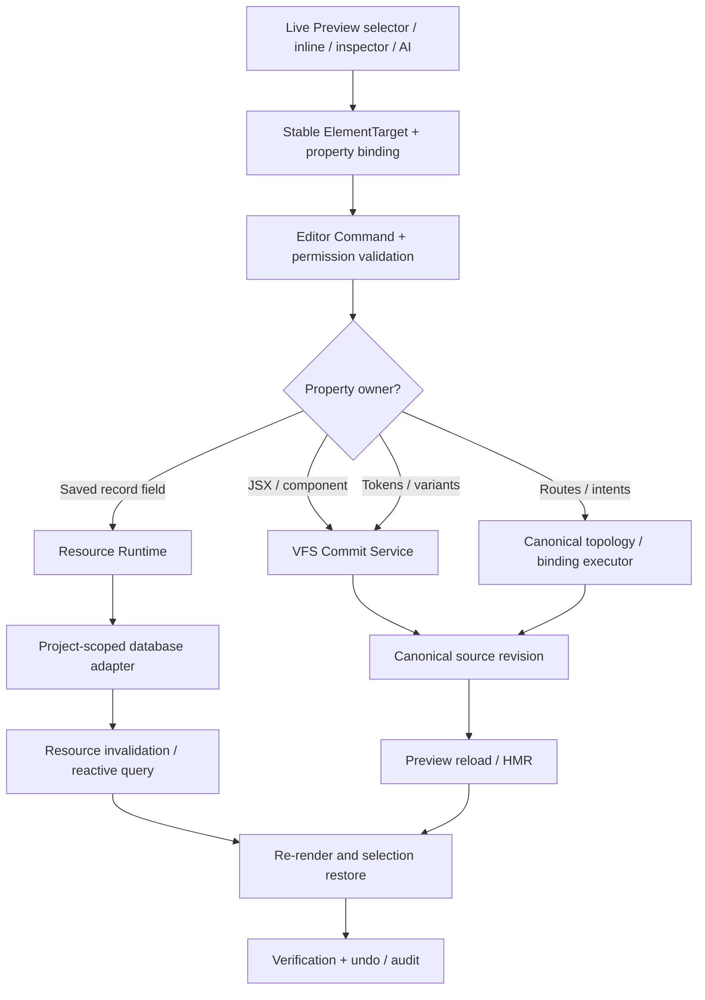

# UNISON OS — Preview-First Resource & Editing Consolidation Milestone

**Date:** October 11, 2026  
**Source audited:** user-provided `unisonOS-main 2.zip` (2,944 ZIP entries)  
**Status:** Architectural guideline, not implemented changes. Paths below refer to `unisonOS-main/` ZIP root. Verify line positions against your working branch before applying patches.

## Executive decision

Make Live Preview the primary contextual editing *surface*. Keep structured Resource Runtime, source VFS, design tokens, navigation topology and intent bindings as distinct *authorities*. Retire duplicated product/service/copy and asset editing experiences inside Creator's Playground. **Do not combine all database records into one universal table**, delete Playground models immediately, or pretend a text node and business product are the same kind of entity. Unify the editor's **object vocabulary and commands**, preserving distinct resource schemas/storage semantics.

### Critical distinction

- **Object** = any selectable rendered node with stable provenance (source node, resource record field, component section, design token, route, intent).
- **Resource** = persistently stored structured domain record, including catalog items, editorial content, and business profile.
- **Catalog** = resource subtype with commercial/operational fields and constraints (products, services, menus, projects, testimonials when registry currently treats them as catalog).
- **Content** = editorial/longform resource subtype (articles, case studies, FAQ), and also a general UX noun for editable displayed information. Rename ambiguous UI references to **Resources** to avoid dual meaning.
- **Asset** = uploaded media file and provenance, referenced by one or more object fields, not a second competing record authority.
- **Presentation** = layout, styles, tokens, and component variants; backed by project source/snapshot rather than customer business data.

## File evidence and collision map

1. `src/components/creatives/web-builder/CreatorPlaygroundPanel.tsx` ~lines 136–150 has separate Pages, Funnels, Content, Forms and Business tabs; ~368–404 reads/writes products and services from `playground.creatorData`; ~438–480 edits business profile fields. These duplicate broader structured resource paths.
2. `src/components/creatives/web-builder/CreatorPlaygroundModal.tsx` ~lines 486–501 renders `AssetsSection` for assets/media/products/services and editorial categories, plus pages/funnels/customization. `AssetsSection.tsx` explicitly states read/writes go through `resourceRuntime` and implements longform placement/publication. This modal is not entirely legacy: **move its useful resource logic instead of simply deleting it**.
3. `src/builder/controllers/PlaygroundSyncController.ts` ~lines 4–24 describes VFS → hydrate → PlaygroundState → compile → VFS/router/bindings. This is a potential stale-state overwrite path. Check exact invocation sites and tests before disabling compiler writes.
4. `src/pages/BusinessCatalog.tsx` exposes `/business/:catalogKey` routed by `catalogSurfaceRegistry`; `src/pages/BusinessContent.tsx` has independent CMS content-type/record workflows. Multiple UIs are not inherently a bug; competing write paths, schema ownership or stale caches are.
5. `src/platform/core/catalogSurfaceRegistry.ts` contains surfaces for service, product, menu_item, pricing_plan, offer, testimonial, project and availability_slot. `src/services/resources/resourceRegistry.ts` explicitly sits above it, dynamically registers `content:` content types, and includes business profile. **Extend Resource Registry instead of replacing Catalog Registry.**
6. `src/services/resources/resourceRuntime.ts` is documented as common read/write surface for catalog, content and profile; it emits resource invalidations. Audit its dedicated-project-backend path: its code says dedicated sites support only catalog adapter at present, so content/profile edits may need routing extensions before tenant-isolated rollout.
7. `src/services/editor/editorCommandTypes.ts` defines the common command vocabulary and `EditorTarget.resourceMark`. `propertyOwnerResolver.ts` routes resource-marked set-text / replace-asset / update-resource-field to resource; presentations/routes/bindings to respective lanes, otherwise source.
8. `src/services/editor/editorCommandService.ts` checks command permission, asset project ownership, and dispatches to Resource Executor or host-provided lane executors. It may fail with 'This change can’t be saved from here yet' when a host executor is absent. Centralizing caller routing and filling missing executors is essential.
9. `src/components/creatives/web-builder/PropertyInspectorPanel.tsx` and `src/services/builder/propertyInspectorModel.ts` already distinguish catalog-backed vs static slots; `src/services/builder/inspectorPatchExecution.ts` ~line 235 explicitly rejects data-bound literal-text patching with 'Edit it from the content panel.' **Replace that dead-end with a resource command, not direct JSX replacement.**
10. `src/services/builder/builderMutationCoordinator.ts` serializes AI, toolbar, terminal, autosave and catalog saves; `src/components/creatives/WebBuilder.tsx` calls `runExclusive` and `planInspectorExecution`. Reuse this concurrency mechanism, but ensure resource revisions and VFS commits share coherent refresh semantics. There are also legacy-looking Fabric `DirectEditToolbar.tsx` and JSX/source inspection flows: verify real runtime mounts before retiring.
11. `src/services/catalogOperations.ts` claims the AI Builder's only sanctioned catalog mutation surface. Reconcile this with newer Resource Runtime and Editor Command Service; keep one final executable adapter per catalog operation, preserving the existing AI tool vocabulary as thin backwards-compatible adapters.

**Observed risk vs verified failure:** the paths and overlap above are evidenced by source; a live repro of stale overwrite, missing editor hosts, and Supabase RLS cannot be claimed from static ZIP inspection alone.

## Reference model

- **Lovable:** documented stable JSX/DOM tags, source mapping, AST-scoped updates, instant rendered feedback, and a preview-first edit/selection workflow. See https://lovable.dev/blog/visual-edits and https://docs.lovable.dev/features/preview-toolbar .
- **Wix Studio:** editor canvas + inspector backed by datasets connecting rendered elements to CMS collection fields. Business app-owned collections remain distinct from generic CMS data. See https://support.wix.com/en/article/wix-studio-using-the-cms .
- **Replit:** live Preview visual editor lets user select and edit text/images/styles/spacing, alongside code and agent. See https://learn.replit.com/docs/ai-foundations/lesson-4 .

Synthesis: select the rendered element → resolve durable element and property provenance → edit with deterministic command where possible → persist to **one owner** → invalidate and re-render → verify and undo. AI uses the same target identity and commit pipeline for natural-language changes; it should not create a second data store.

## Target flow

## Ownership and edit routing matrix

| User action | Target owner | Commit mode | Live refresh |
|---|---|---|---|
| Edit static hero text | Source-owned JSX/slot (or source-backed snapshot) | deterministic `set-text` source executor → VFS commit | HMR |
| Edit product name/price | `products` catalog record | Resource Runtime update with expected record version | resource invalidation |
| Edit salon service price/duration | `services` catalog record | Resource Runtime | resource invalidation |
| Edit restaurant menu imagery | menu record field + project asset reference | upload asset, then record update | resource invalidation |
| Edit portfolio title/media | `projects` record if bound; source if static | resolved owner | corresponding refresh |
| Edit longform article/case study | `content:*` record + page route/page template | resource update; route only when adding publishing route | resource invalidation + route refresh |
| Edit logo/hero asset | asset reference used in business profile or JSX slot | ownership-aware replace-asset | corresponding refresh |
| Change component spacing or variant | source / presentation token | typed source operation | HMR |
| Update button URL / trigger | route / intent binding | route/binding executor | HMR, action probe |
| Reorder items in a grid | query ordering / placement binding or static topology | owner-resolved operation | owner refresh |

Dynamic content must never be silently converted into inline JSX during visual editing. Distinguish global field edits from **this-instance overrides**; if the latter is desired, create explicit placement override records, not hidden duplicated literals.

## Phased implementation

### M0 — Establish a golden fixture and prove collisions (mandatory)

- Create sandbox project each for salon/service booking, e-commerce, restaurant, portfolio/case study, contractor and static landing page.
- Record current location and backing owner for 10 selected element types per fixture: preview selector mark, source path/line/section, resource key/id/field, expected DB table, active writer.
- Instrument `executeEditorCommand`, `runExclusive`, `commitMutation`, `applyResourceOp`, Playground compile and hydration with correlation IDs and revision IDs.
- Run a test: edit product name in Preview, change layout through AI, perform autosave, reload and publish; determine whether DB or code diverges.
- Capture baseline with existing `src/test/previewSelectionProvenance.test.ts`, `previewSingleOwner.test.ts`, `creatorPlaygroundCanonicalHydration.test.ts`, `playgroundCommitFinalization.test.ts`, `builderMutationCoordinator.test.ts`.

**Exit:** each editable property has exactly one canonical owner, including explicit unsupported states.

### M1 — Unify object metadata and selector

- Extend, rather than fork, `src/services/editor/editorCommandTypes.ts` (`EditorTarget`) with versioned `objectId`, `ownerKind`, `resourceKey`, `recordId`, `field`, `instanceId`, stable source locator, `siteId`/`projectId` and context fingerprint where needed.
- Preserve/use `data-ut-resource="resourceKey#recordId.field"`, but use stable JSX element mapping for static or AI-authored content; resource mark by itself does not identify complex section instances or repeated records adequately.
- Select element → resolve property binding → inspector model. If uncertain, provide read-only or explicit 'Choose binding' action; never guess first matching JSX tag.
- Introduce `EditableObjectDescriptor` as **view model only**, not a new data authority.

**Exit:** preview selection reliably survives rerenders and identifies correct field for repeated cards.

### M2 — Make Preview the sole primary edit UI

- Adapt `PropertyInspectorPanel.tsx` for text, rich text, URLs, media, price/duration, visibility, layout, asset/media picker, action/intent and explicit owner status.
- Wire `set-text`, `replace-asset`, `update-resource-field`, `set-link`, token edits, reordering and AI selection through `executeEditorCommand` consistently. Fill all required non-resource lane executors from the Builder host.
- `inspectorPatchExecution.ts`: on data-bound text/media, resolve resource command instead of telling users to open the content panel.
- Support optimistic preview with pending/error/rollback states. Save immediately or explicitly via Save/Apply; never imply an uncommitted optimistic change persisted.
- Keep image upload storage, media library and file attachments accessible **from Preview context**; a media manager can remain as a library, but not as a separate required editing step.

**Exit:** all six fixtures allow at least basic inline text, image and URL edits directly from selection, surviving reload.

### M3 — Resource vocabulary consolidation without destructive schema migration

- Keep `catalogSurfaceRegistry.ts` as type-specific contract (products, services, menus, testimonials, projects, availability slots etc.).
- Keep dynamic CMS types and resource registry, but present them through a unified resource picker: `resources: [{key,kind,schema,storage,scope,capabilities}]`.
- Rename consumer-facing 'Content vs Catalog' distinction to **Records / Collections** or **Site Data**, with filtered type tabs (Commerce, Services, Portfolio, Editorial, Testimonials, Business Profile).
- Evaluate whether `testimonials`, `projects`, and `FAQs` currently have dual definitions between catalog surfaces and content types. Assign **one preferred canonical record type per business use case** and implement an explicit import/alias migration when collisions exist. Do not delete records pre-migration.
- Keep price, booking and inventory invariants in per-type schemas. Price cents remain integer at persistence boundary; editor formats currency for users.
- Treat asset library as reusable media store, with asset IDs/URLs in record fields.
- Old AI catalog tools in `catalogOperations.ts` should delegate to the same Resource Runtime adapters, or be explicitly designated the single implementation backing that runtime; avoid two unrelated Supabase writes.

**Exit:** a project/portfolio/media record appears only once in site data and edits from either Preview or admin view are consistent.

### M4 — Retire Creator's Playground overlap safely

- `CreatorPlaygroundPanel.tsx`: remove/deprecate Products, Services and Business copy editors after Preview parity; page navigation should relocate to normal Builder Pages/Layers controls.
- `CreatorPlaygroundModal.tsx`: migrate `AssetsSection` resource editing, rich-text, longform placement, and media selection into reusable Inspector drawers/pickers before removing tabs. Keep launch checklist, booking/automation setup, funnels and app operations in a slim **Business Operations** panel if still needed.
- `PlaygroundSyncController.ts`: hydrate only for migration/read-only topology compatibility; prohibit Playground recompile from overwriting AI-authored source or committed record values. For required topology edits, delegate to canonical topology route; do not synthesize full VFS from stale `CreatorData`.
- `useCreatorPlayground` and PlaygroundState: remove only after checking all imports plus wizard bootstrapping, legacy drafts and migration tests. Use feature flag `previewFirstResources` and an explicit schema migration path.

**Exit:** no parallel resource editor is required, no silent recompile overwrites source or records, legacy projects still open.

### M5 — Project-tenant backend support

- Verify scopes and RLS on site/business/project identifiers for all `resourceRuntime.ts` adapters, storage uploads, AI actions and published reads.
- Investigate `resourceRuntime.ts` dedicated-project backend branch: currently visibly limits dedicated backend operations to catalog; extend for content and profile with consistent API, or adopt one supported per-tenant unified adapter.
- Physical separate Supabase project/database per customer is an *optional isolation architecture*, **not equivalent to scoping tables by siteId**. Make explicit which tenancy tier is used; do not assume each Unison site automatically has a dedicated database.
- Ensure draft vs published record status, public read policies and private write policies are cleanly separated; confirm service role secrets never appear in client bundles.
- Use expected revision or concurrency control for record updates to avoid last-write-wins overwrites, and persist audit/undo metadata.

**Exit:** editing project A cannot read/write project B; published runtime reflects permitted edits and not uncommitted drafts.

### M6 — Bring in-builder AI into the same execution plane

- AI receives selected `EditableObjectDescriptor`, field ownership, schema, permissible operations, relevant source locations, design-system context and active revisions.
- Deterministic requests become Editor Commands. Rich refactors yield typed candidate VFS operations tested and committed through existing VFS service. Data edits route through Resource Runtime; AI must not rewrite JSX to fake a database change.
- Reuse `runExclusive` for source-affecting saves; separately manage resource update conflicts and resynchronization. Provide explicit cross-domain plan/checkpoint for edits involving DB plus source (e.g. create case study + dynamic page).
- Run preview verification (click, route, action probe and persistence reload), restore selection, expose undo.

**Exit:** same single field edit by AI, visual inspector and keyboard yields the same durable state.

### M7 — Validation and beta gate

Automate cases:

1. Repeated product card: update 2nd card image; first and third unchanged; survives refresh.
2. Restaurant menu item: update price and category; business data and deployed public route agree.
3. Salon booking: change service duration; booking capability uses new duration and respects availability constraints.
4. Portfolio project: upload media, attach to project, edit title, create/open case study and published detail page.
5. Source-owned hero: inline text changes VFS exactly once; AI style change doesn't discard copy.
6. Two editors concurrently: stale edit detected rather than overwriting newer revision.
7. Autosave + AI + Playground: no false recompile or stale data restoration.
8. Unbound visual element: no incorrect inferred DB write; clear appropriate action.
9. Tenant isolation: project A asset or record rejected in project B.
10. Undo, offline/error, reopen and publish verification.

Metrics: successful owner resolution >= 99% for instrumented supported elements; supported edit-save-reload >= 99%; zero known cross-project writes or source overwrite regressions; 100% scoped business operations tested. Thresholds are proposed release targets, not measured numbers.

## Safe implementation sequence

**First PR:** instrumentation + ownership fixture matrix, no user-facing removal.  
**Second PR:** selection metadata + inspector direct routing and source/resource executors.  
**Third PR:** data-bound text/image fixes, dynamic record invalidation, upload picker.  
**Fourth PR:** unified Resources UX, content/catalog aliases and tenant adapters.  
**Fifth PR:** Playground overlap removal behind feature flag and compatibility migration.  
**Sixth PR:** cross-industry E2E + public publish gates.

## Rules for implementation agent

1. Inspect current imports and call sites before edits; run focused tests after each tranche.
2. Do not add another backend API unless the current project backend cannot safely expose necessary typed operations; prioritize extending existing Resource Runtime and command adapters.
3. No duplicate persisted content in JSX and database without an explicit controlled override schema.
4. Preview is a *surface*, not a data authority. Never make DOM the canonical store.
5. Keep AI-authored TSX authoritative for source-owned edits; never run stale Playground compile as a repair step.
6. No regex-only unverified source patch on ambiguous JSX; use stable locators/AST patch + verification and reject uncertain matches.
7. Catalog and CMS schema boundaries may differ even while the editor shows them together.
8. Each edit needs target, owner, baseline revision, permission, resulting revision and invalidation/undo semantics.
9. Preserve wizard launch and legacy drafts until migrations are proven.
10. Never claim full WYSIWYG parity based solely on edit controls existing; prove real database persistence and deployed site hydration.

## Concise project decision

**Delete unnecessary editing hops, not necessary domain architecture.** Preview-first + one command layer + owner-resolved source/resource writes + verified runtime refresh is the next beta-critical milestone. Keep Playground only as a reduced operations/launch surface after extracting its useful code.
